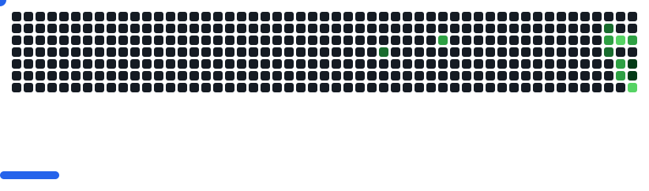
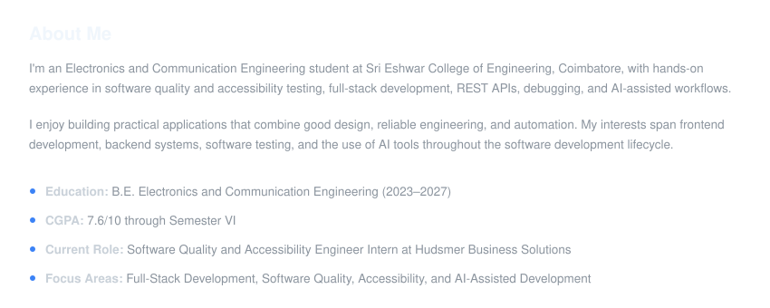
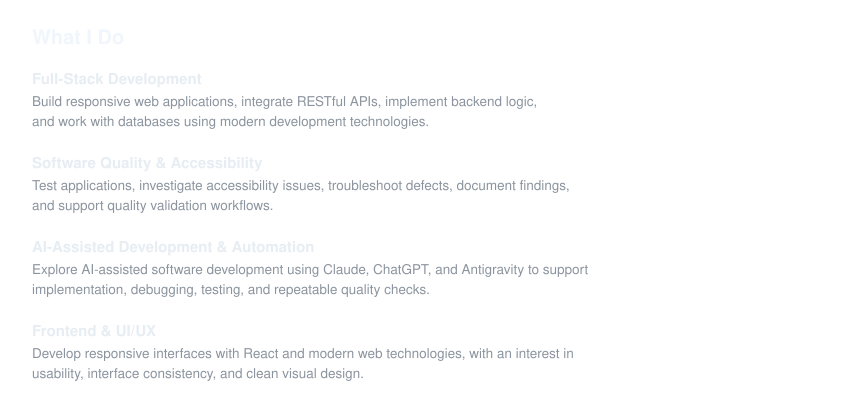
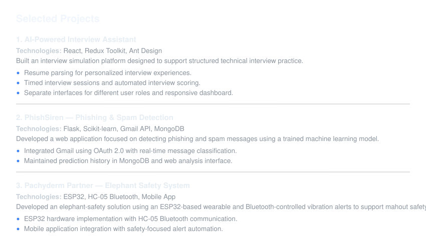
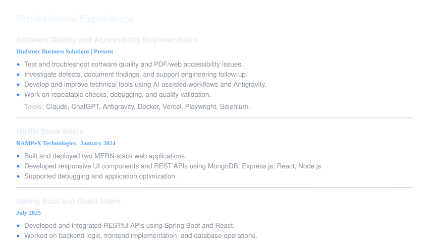

 

# Pranav Karthick S K

### Creative Developer · Software Quality · Full-Stack Development · AI Automation · UI/UX

Building clean interfaces, practical web applications, and better digital experiences.

 

&nbsp;

&nbsp;

&nbsp;

&nbsp;

  

<picture>
  <source media="(prefers-color-scheme: dark)" srcset="./breakout-dark.svg" />
  <source media="(prefers-color-scheme: light)" srcset="./breakout-light.svg" />
  
</picture>

---

---

---

---

---

---

---

---

## Problem Solving

  

&nbsp;

&nbsp;

I regularly practice Data Structures and Algorithms to strengthen problem-solving skills and improve my understanding of programming fundamentals.

---

## GitHub Activity

  

---

## Currently Exploring

`AI Automation` · `AI-Assisted Development` · `REST APIs` · `Advanced React` · `Software Testing` · `Accessibility` · `Cloud & Deployment`

---

## Let's Connect

I'm interested in opportunities involving full-stack development, software engineering, frontend development, AI-assisted development, and software quality engineering.

<a href="https://portfolio-devoloper.vercel.app/">Portfolio</a>
&nbsp; • &nbsp;
<a href="https://github.com/pranavkarthick12">GitHub</a>
&nbsp; • &nbsp;
<a href="https://www.linkedin.com/in/pranav-karthick-s-k-516304291">LinkedIn</a>
&nbsp; • &nbsp;
<a href="https://mail.google.com/mail/?view=cm&fs=1&to=pranavkarthicksk@gmail.com">Email Me</a>

  

<i>Building at the intersection of design, development, and automation.</i>

